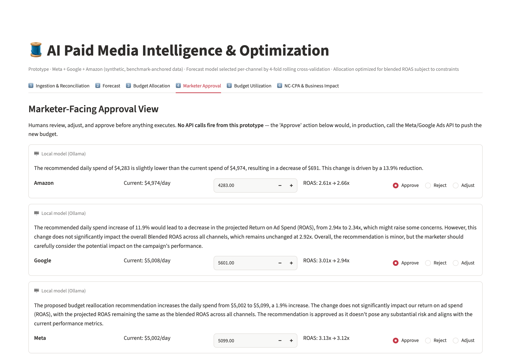
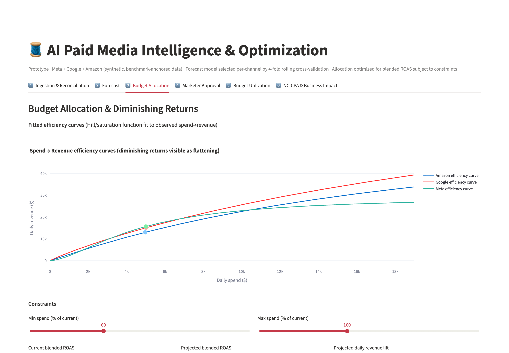
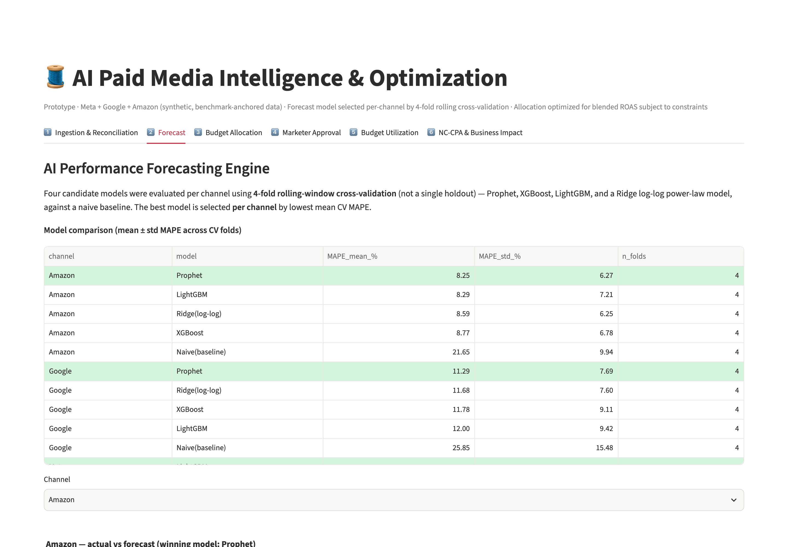
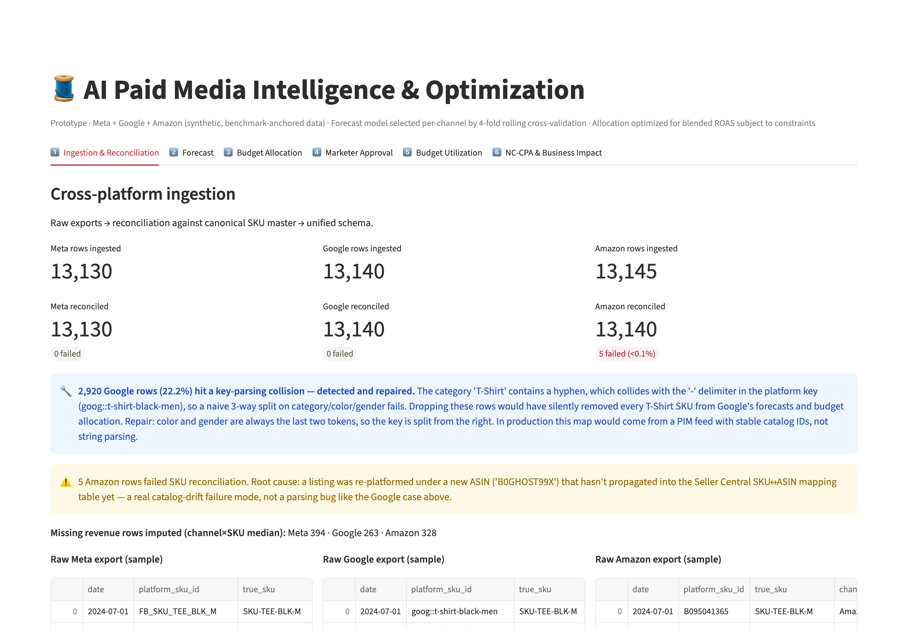

# AI Paid Media Intelligence & Optimization

[](https://paid-media-intelligence.streamlit.app)
[](https://github.com/ayushimodi18/paid-media-intelligence/actions/workflows/tests.yml)


**Live demo:** https://paid-media-intelligence.streamlit.app
*(The app may take ~30 seconds to wake up if nobody has opened it recently. The hosted demo uses the template narrator, since a local Ollama model isn't available there.)*

A production-structured prototype covering ingestion, validation, feature
engineering, EDA, cross-validated forecasting, budget allocation, and a
marketer approval view — built for a direct-to-consumer (DTC) apparel
brand selling across Meta, Google and Amazon.

## Highlights

- **End-to-end pipeline, 11 stages** — raw ad-platform exports → validation gates → SKU reconciliation → features → EDA → model selection → budget optimization → business impact, with structured logging and a run manifest.
- **Forecasting that beats the baseline** — 4 models (Prophet, XGBoost, LightGBM, Ridge) compared per channel with 4-fold rolling-window cross-validation. Best-model MAPE vs. naive baseline: **Amazon 8.3% vs 21.6%**, **Google 11.3% vs 25.9%**, **Meta 14.1% vs 18.7%**.
- **Constrained budget optimizer** (Hill saturation curves + SLSQP) that surfaces a non-obvious finding: reallocation alone *can't* reach the 4.0x ROAS target because every channel has converged to ~2.3x marginal ROAS — the lever is total spend, not the split.
- **Data quality caught and fixed** — 2,920 Google rows (22%) failed SKU matching because the category "T-Shirt" collides with the `-` key delimiter. Dropping them would have silently removed every T-Shirt SKU from Google's analysis and **understated Google's daily spend by 37%**; the pipeline detects the collision, repairs it with delimiter-aware parsing, and records how each row was matched. A separate Amazon catalog-drift case (unmapped ASIN) is flagged and excluded.
- **Grounded LLM explanations** — a local model (Ollama) or Claude drafts the marketer-facing "why"; a precision-aware fact-checker rejects any number not traceable to the optimizer's output and falls back to a deterministic template.
- **29 automated tests** run on every push via GitHub Actions — including feature-leakage prevention, validation-gate behavior, optimizer constraints and hallucination control.

> **Data note:** ad performance data is synthetic, calibrated to cited 2026 industry benchmarks (see [Benchmark sources](#benchmark-sources-compiled-july-2026)). Methods are built to run unchanged on real exports.

## Screenshots

| Marketer approval (LLM-drafted, fact-checked) | Budget allocation & diminishing returns |
|---|---|
|  |  |
| **Forecast model comparison (rolling CV)** | **Ingestion & reconciliation** |
|  |  |

## Quickstart

```bash
pip install -r requirements.txt

# Run the full pipeline (generates data, validates, builds features, runs EDA,
# cross-validates models, runs the optimizer) end to end:
python src/pipeline.py

# Or reuse already-generated data and just rerun downstream stages:
python src/pipeline.py --skip-generate

# Run the test suite:
pytest tests/ -v

# Launch the interactive walkthrough:
streamlit run app.py
```

## API Keys (optional)

> **No API keys are included in this repository.** The keys shown below are placeholders.

The project runs fully **without any API key**. The recommendation narrator tries, in order:

1. **Ollama** (local, free, no key): install [Ollama](https://ollama.com), then `ollama pull llama3.2`
2. **Claude API**: used only if Ollama isn't running and a key is provided
3. **Deterministic template**: automatic fallback when neither is available

To use the Claude API, set the key as an environment variable:

```bash
# macOS / Linux
export ANTHROPIC_API_KEY=sk-ant-your-api-key-here

# Windows (PowerShell)
$env:ANTHROPIC_API_KEY="sk-ant-your-api-key-here"
```

Or paste it into the optional key field in the Streamlit app. Optional Ollama settings: `OLLAMA_MODEL` (default `llama3.2`) and `OLLAMA_HOST` (default `http://localhost:11434`).

Never commit a real key. `.env` files are already listed in `.gitignore`.

## Project structure

```
paid-media-intelligence/
├── app.py                       # Streamlit app — 6 tabs, the live demo
├── requirements.txt
├── README.md                    # this file
├── src/
│   ├── pipeline.py              # production orchestrator — 11 stages, structured logging
│   ├── generate_data.py         # M1: benchmark-anchored synthetic data generator
│   ├── ingest_reconcile.py      # M1: cross-platform SKU reconciliation
│   ├── validation.py            # data validation (pandera schemas + business rules)
│   ├── feature_engineering.py   # standalone, testable feature engineering layer
│   ├── eda.py                   # exploratory data analysis (charts + report, scripted not notebook)
│   ├── forecast_engine.py       # M2: cross-validated model comparison + selection
│   ├── optimize_allocation.py   # M3: efficiency curves + constrained budget optimizer
│   ├── budget_utilization.py    # M3 extension: waste/underspend detector (tertiary success metric)
│   ├── nc_cpa.py                # secondary success metric: NC-CPA, split by prospecting/retargeting
│   ├── llm_narrator.py          # the one real LLM call — grounded, with hallucination control
│   └── business_impact.py       # DIO / stockout / fulfillment cost translation layer
├── tests/
│   └── test_pipeline.py         # 29 pytest tests across all stages
├── data/                        # generated CSVs + all intermediate/output artifacts
└── outputs/eda/                 # EDA charts (PNG) + markdown report
```

## What's real vs. mocked

| Component | Status |
|---|---|
| Meta + Google + Amazon ad performance data | **Synthetic, benchmark-anchored.** CPC, CTR, and ROAS for every row are sampled within ranges taken from cited 2026 industry benchmark reports (apparel/ecommerce vertical). Diminishing returns emerge from auction-saturation logic, not an arbitrary curve fit. **730 days, 18 SKUs, 3 channels, ~39,400 raw rows.** See "Benchmark sources" below. |
| Data validation | **Real, running pandera schemas** + custom business-rule checks (duplicate keys, referential integrity, missingness thresholds, implausible-ROAS sanity checks). The pipeline has a hard validation gate — it stops before modeling against data that fails schema or referential-integrity checks. |
| Feature engineering | **Real, tested.** Calendar features (cyclical encoding), lag/rolling features (leak-safe — verified by unit test), outlier winsorization (capped, not dropped), log transforms. |
| EDA | **Real**, scripted (not a one-off notebook) — 7 charts + a numeric summary table + a markdown report, regenerated on every pipeline run. |
| Forecasting models (Prophet, XGBoost, LightGBM, Ridge log-log) | **Real models, real training, real 4-fold rolling-window cross-validation** (not a single lucky/unlucky holdout). Reports mean ± std MAPE per model per channel. |
| Budget allocation optimizer | **Real constrained optimization** (SLSQP). Surfaces a genuine, non-obvious finding: even the optimal reallocation can't reach the project's 4.0x blended ROAS target, because all channels have converged to similar marginal ROAS — the constraint is total spend, not misallocation. |
| Budget waste/underspend detector | **Real**, addresses the project's tertiary success metric directly. Honest limitation stated in-app: no hourly pacing data exists in this dataset, so true "hit the cap by noon" detection isn't possible — a documented daily proxy (90th-percentile historical spend as ceiling) is used instead. |
| Marketer approval view | **Real UI**, fully interactive. No execution happens — submitting just records the decision. |
| Ads API calls | **Stubbed.** No live credentials. |
| Automated tests | **Real**, 29 pytest tests, run on every push via GitHub Actions: reconciliation correctness (the Google delimiter collision is detected and repaired, and no Google rows are lost), feature-leakage prevention, validation gate behavior, optimizer constraint compliance, budget-flag mutual exclusivity, LLM groundedness (fabricated and near-miss numbers rejected, honest rounding accepted). All passing. |
| Microsoft | **Out of scope for this slice** by design — the scope allows picking 2-3 platforms. |
| NC-CPA (secondary success metric) | **Real, computed from raw exports** — split by prospecting vs. retargeting (the dimension the requirements specifically ask for), not just blended per channel. Currently all channels are within the $45 cited target even while blended ROAS misses its target — a real, differentiated finding (the problem is auction saturation, not overpaying for new customers). |
| LLM integration | **Real, one genuine call, 3-tier provider chain**: (1) a local open-source model via Ollama (default — free, no API key, no third-party data exposure, no external uptime dependency), (2) the Claude API if a key is provided and Ollama isn't reachable, (3) a deterministic template if neither is available. Powers the recommendation narrator in the marketer approval view. Hallucination control applies regardless of provider: constrained context (only the relevant numbers, nothing else), explicit no-invented-figures instruction, and a post-hoc, **precision-aware** groundedness check: every number in the output is matched against the inputs at the precision it was written with ("2.94x" must match an input that rounds to 2.94; "99.9" can never pass as a rounding of 100) — a failed check falls back to the template rather than risk showing a fabricated number. |
| DIO / stockout / fulfillment cost linkage | **Real**, built from the existing budget waste/underspend flags, translated into inventory-economics language and grounded in cited 2026 DTC apparel benchmarks (DIO range, turn targets, return rates, shipping cost %). Explicitly framed as directional/illustrative, not a precision financial model — stated in the UI, not hidden behind false precision. |

## Pipeline architecture

`src/pipeline.py` orchestrates 11 stages with structured logging and a
machine-readable run manifest (`data/pipeline_run_manifest.json`):

```
01 generate_synthetic_data  →  02 validate_raw_exports  →  03 ingest_and_reconcile
  →  04 validate_unified  →  05 feature_engineering  →  06 eda
  →  07 model_cv_and_selection  →  08 budget_utilization  →  09 budget_allocation_optimization
  →  10 nc_cpa_secondary_metric  →  11 business_impact_dio_fulfillment
```

Each stage is timed and wrapped so a failure names the exact stage and
reason rather than surfacing a raw traceback. Validation stages (02, 04)
are **gates**: hard errors (schema violations, duplicate keys, referential
integrity failures) stop the pipeline before wasting compute on modeling
against bad data; warnings (e.g. expected missing-revenue rates) log but
don't block. Run `python src/pipeline.py --fail-on-warning` for strict mode.

## Data validation approach

Two tiers, in `src/validation.py`:
1. **Schema validation** (pandera): column presence, dtypes, value ranges
   (spend ≥ 0, percentages in [0,1], channel ∈ {Meta, Google, Amazon}).
2. **Business-rule validation**: duplicate (date, platform_sku_id) keys,
   missing-revenue rate thresholds, date-range continuity, referential
   integrity of SKU against the canonical product master, implausible-ROAS
   sanity flags (>50x).

Both produce a structured `ValidationReport` (pass/fail + errors +
warnings) rather than raising opaque exceptions — built so a future
Streamlit "data health" panel or CI step could consume it directly.

## Feature engineering approach

`src/feature_engineering.py`, independently testable:
- **Calendar features**: day-of-week, month, weekend flag, holiday-window
  flags (BFCM/Christmas/New Year/Summer Sale/Back-to-School), plus
  cyclical sin/cos encodings for models that care about distance (Ridge),
  not just split thresholds (trees).
- **Lag + rolling features** (1/7/14-day lags, 3/7/14-day rolling mean &
  std): computed strictly on `shift(1)` before rolling, verified by unit
  test to never include the current day's own value (leakage check).
- **Outlier handling**: winsorized at 1st/99th percentile, not dropped —
  preserves BFCM/Christmas spend spikes as real signal rather than
  deleting them, with a `_was_outlier` flag column for transparency.
- **Log transforms** for skewed monetary columns.

## EDA summary
See `outputs/eda/eda_report.md` and the 7 PNG charts for the full
output. Headline findings:
Every finding below is computed by `src/eda.py` on each run, not hand-written:
- Blended ROAS across the dataset is **2.86x**, below the project's 4.0x
  target on all three channels (see `03_roas_boxplot.png`).
- **4.9%** of rows are IQR-based spend outliers — over-represented in the
  Nov 20–Dec 31 holiday window (32% of outliers vs. 11% of rows) and
  concentrated in high-spend T-Shirt SKUs (68% from three of them). Handled via winsorization, not deletion.
- Weekend revenue runs **17–20% above weekdays** on every channel
  (`04_weekly_seasonality.png`).
- Daily spend/revenue correlation is strong for Amazon and Google
  (0.89 / 0.88) but weaker for Meta (0.69) — consistent with Meta's noisier
  attribution and its harder forecasting problem.
- **ROAS is nearly flat across SKU tiers** (≤0.03x spread within a channel):
  tiering decides *how much* each SKU gets, not how efficiently it converts
  (`07_sku_tier_performance.png`).

## Model evaluation methodology
Four candidates (Prophet, XGBoost, LightGBM, Ridge on log-log features)
evaluated per channel via **4-fold rolling-window time-series
cross-validation** — each fold's test window is a fixed-size block walking
forward through the series with strictly prior data as training, avoiding
the single-holdout problem (one lucky/unlucky window deciding the winner).
Reports mean ± std MAPE per model per channel; selection is by lowest mean
CV MAPE. Current result: **Amazon → Prophet, Google → Prophet, Meta →
LightGBM** (Meta's models barely beat naive, 14.1% vs 18.7% — explainable
by the recurring attribution-shock noise injected into that channel, not a
modeling failure).

## Budget allocation methodology
Efficiency curves fit per channel via a Hill/saturation function, fresh
from observed data (not ground-truth generator parameters). Marginal ROAS
(the curve's derivative) is the decision variable for a constrained SLSQP
optimization. **Key finding**: at current spend levels, all three channels
have converged to similar marginal ROAS (~2.3x) — meaning reallocation
alone cannot close the gap to the project's 4.0x target. The system correctly
flags this and recommends budget reduction / SKU-efficiency work as the
next lever, rather than recommending further reshuffling it can't justify.

## Benchmark sources (compiled July 2026)
All figures are **ranges** — different benchmark-reporting agencies
disagree by meaningful margins, which is normal for aggregated industry
data, not a quality issue. The generator samples within range rather than
using single point estimates.

- **Meta apparel**: CPC ~$0.45, CTR ~1.2–2.0%, CPA ~$31; retargeting ROAS
  5-10x vs. prospecting ROAS ~2-3x. *(get-ryze.ai 2026 Meta Ads
  benchmarks; hawky.ai 2026 ROAS benchmarks by industry)*
- **Google ecommerce/retail**: CPC ~$1-2, typical conversion rate 3-5%,
  target ROAS 3-5x. *(ppcchief.com, WordStream-sourced 2026 PPC
  benchmarks; hawky.ai)*
- **Amazon apparel**: CPC ~$2.15, ROAS ~3.35x (implied ACOS ~30%), CTR
  ~0.47%; category ACOS more broadly reported 28-42% across sources.
  *(get-ryze.ai 2026 Amazon Ads benchmarks; Trellis, Autron, Accrue 2026
  Amazon benchmark posts)*

**Methodology note**: where a single source reported CPC, CVR, and ROAS
together for the same metric set, that internally-consistent triple was
used rather than mixing point estimates across sources — mixing produced
nonsensical implied conversion rates in early iterations. Where sources
disagreed on a single metric, values were sampled within the reported
range with ROAS treated as the primary anchor (also the project's primary
success metric).

**Residual limitation, stated plainly**: calibrating *aggregate* benchmark
statistics is not the same as having *real account-level data*. Real
campaigns carry auction-level noise, audience-overlap effects, and
autocorrelation structure no benchmark report captures. This is the most
rigorous version of "synthetic" achievable without live API credentials,
not a substitute for one.

## What I'd build next with two more weeks
1. **Amazon + Microsoft connectors** extended with real ASIN/audience-network reporting nuances.
2. **PIM-backed SKU reconciliation** replacing string-parsed platform keys with stable catalog IDs.
3. **NC-CPA as a hard optimizer constraint**, not just a reported/tracked metric.
4. **Hourly pacing data** to make the budget-utilization detector exact ("hit cap by noon") rather than a daily proxy.
5. **Metric-aware LLM groundedness** — the current check verifies every number exists in the inputs at its written precision; next step is verifying each number is attributed to the *right* metric (e.g. a real ROAS value not mislabelled as marginal ROAS).
6. **Confidence-aware allocation** — widen optimizer bounds for channels with higher forecast uncertainty (Meta's wider CV variance) instead of treating all point forecasts as equally trustworthy.
7. **Validation gate in CI** — tests already run on every push; next is running the pipeline's data-validation gate in CI so a bad data change fails the build too.
